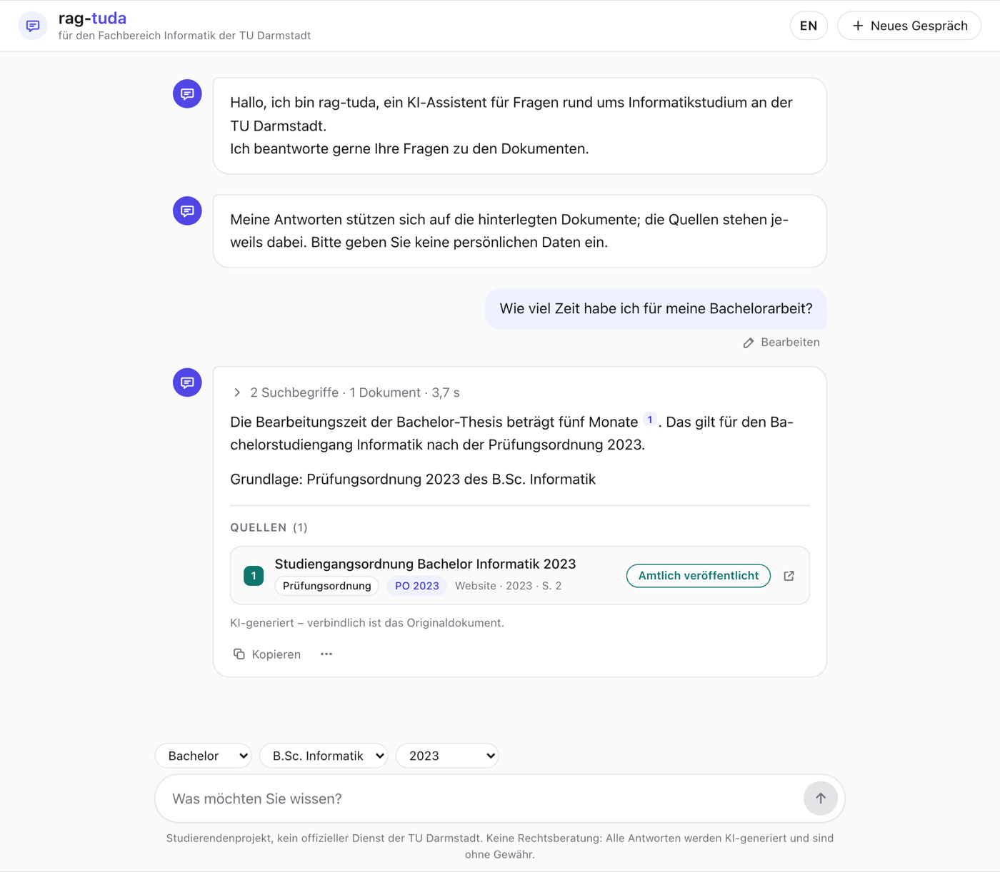
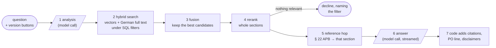
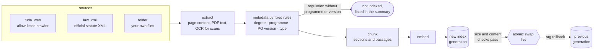
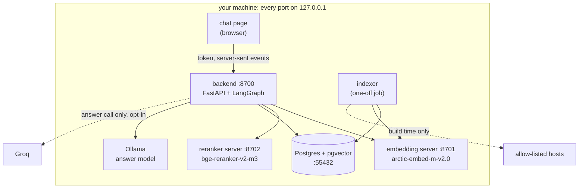

# rag-tuda

**Ask a question about the study rules of TU Darmstadt's computer science department and get an answer that cites
the exact regulation, for your degree and your version of the examination regulations, from a 4B open-weight model
running on your own laptop.**

<p align="center">
  
  <br><sub>A real answer of the default 4B model with the version chips set to PO 2023, over the project's fixture copy of
  the department's site (example text, not the real regulations).</sub>
</p>

> An independent student project. **Not an official service of TU Darmstadt and not legal advice.** Every answer is
> AI-generated and without guarantee: check the cited source.

**Status:** measured end to end on one 16 GB Mac with the small model class (4B models). The larger classes (27B to 35B
models on a bigger Mac, hosted models on Groq, vLLM on NVIDIA GPUs) are written but **not tested yet**.

## Why it is interesting

- **A 4B model on a laptop passes 32 of 35 test questions.** The default model is Qwen3 4B Instruct (a 2.5 GB
  download). On an Apple M2 Pro with 16 GB it passed the checks of 32 of the project's 35 test questions, with a median
  of 26 s per answer. No GPU server, no API key, no proprietary model. ([the fine print](#results))
- **It cites the right version of the rules, or refuses.** A degree programme has several versions of its examination
  regulations (*Prüfungsordnung*, PO) in force at once. Degree, programme, PO version and document type are database
  columns that the crawler fills by fixed rules, never by a model. Once a question names a version, they become hard SQL
  filters, so a source of another version cannot be cited. A regulation whose programme or version cannot be read is not
  indexed at all.
- **The parts that must be right are code, not prompt.** The citation list, the "Based on: PO 2023 of the B.Sc.
  Informatik" line, the residence-law disclaimer and the note that an English translation is not binding are added by
  code, from the sources the answer cites.
- **A retrieval pipeline you can take apart.** Hybrid search (vectors plus German full text), a fusion step, a
  cross-encoder that reranks whole sections, and a rule-based hop that follows references such as "§ 22 APB" (the
  university's general examination rules) without a model call. `rag eval --retrieval-only --ablation` measures what each stage adds.
- **Local, private and safe to rebuild.** Everything listens on `127.0.0.1` behind a token, with no telemetry. The crawler
  keeps to a host allow-list, one request per second and `robots.txt`. Every index build is a new generation that goes
  live in one atomic swap, and `rag rollback` brings the previous one back.

## Try it without a crawl

The bundled `example` profile indexes ten German federal labour laws from files in the repository, so nothing is
crawled. You need:

| What | Why |
|---|---|
| An Apple-silicon Mac with 16 GB or more | native mode; on x86_64 Linux or WSL2 see [Compose mode](#compose-mode-x86_64-linux-or-wsl2) |
| Docker (Colima, OrbStack or Docker Desktop) | Postgres runs in a container |
| [`uv`](https://docs.astral.sh/uv/) | runs the Python projects |
| [Ollama](https://ollama.com), running (`ollama serve`) | serves the answer model; on a 16 GB Mac start it as `LLAMA_ARG_CACHE_RAM=1024 ollama serve` ([why](handbook/models.md#a-16-gb-mac)) |

```sh
git clone https://github.com/ritvikmaini/rag-tuda.git && cd rag-tuda
uv run rag doctor                       # checks the machine and lists the models it can run
uv run rag up --profile example --yes   # downloads the models once, builds the index, prints the chat page's link
uv run rag ask "Wie viele Tage Urlaub stehen mir im Jahr mindestens zu?"
uv run rag down                         # stops everything; the index stays
```

The first `rag up` downloads about 6 GB of models: the answer model and the embedding and reranking models (`rag doctor`
prints each size; its 6.5 GB total also counts the PDF models the TU profile needs). Without `--yes` it asks first, and a
model already on the machine is not downloaded again. Open the printed link for the chat page. The example profile
answers in German, from those ten laws only (`rag ask` lists one line per retrieved passage, so a law can appear twice):

```text
$ uv run rag ask "Wie viele Tage Urlaub stehen mir im Jahr mindestens zu?"
- analysing
- understood: Wie viele Tage Urlaub stehen mir im Jahr mindestens zu?
- searching: Mindesturlaubsgesetz Dauer Urlaub im Jahr; Mindesturlaub Arbeitsnehmer Anspruch
- found: 1 documents, 2 passages
- writing

Ihnen stehen im Jahr mindestens 24 Werktage Urlaub zu [1]. Als Werktage gelten alle Kalendertage, die nicht Sonn- oder
gesetzliche Feiertage sind [1].

[1] Mindesturlaubsgesetz für Arbeitnehmer - https://www.gesetze-im-internet.de/burlg
[2] Mindesturlaubsgesetz für Arbeitnehmer - https://www.gesetze-im-internet.de/burlg
```

## Ask about TU Darmstadt's study rules

The default profile, `tu-informatik`, covers the Bachelor, Master and doctoral rules of the computer science department
(*Fachbereich Informatik*), the university-wide regulations, semester dates and fees, and the residence permit for
studying. It crawls the university's public pages on your machine; no index ships with the repository.

```sh
uv run rag up    # crawls the listed TU hosts (about 8 minutes on an M2 Pro), builds the index, prints the link
uv run rag ask "Wie viele Wochen habe ich Zeit für die Bachelorarbeit?" --degree bachelor
```

Questions from its test set ([`profiles/tu-informatik/smoke/smoke_v1.json`](profiles/tu-informatik/smoke/smoke_v1.json)),
in German or English:

- *Wie viele Wochen habe ich Zeit für die Bachelorarbeit?*
- *Wie viele Leistungspunkte hat die Masterarbeit im M.Sc. Informatik nach der PO 2023?*
- *Kann ich mich rückwirkend für ein Semester beurlauben lassen, das schon vorbei ist?*
- *Which English level do I need for the Master's programme Computer Science?*
- *How soon after I arrive in Germany do I have to register my address?*

On the page, three buttons (degree, programme, PO version) set your regulations once, so "How long is the thesis?" is
answered for *yours*; a version named in the question ("nach der PO 2015") wins for that question. German answers use the
formal "Sie", an English question gets an English answer, and where a German and an English version of a regulation both
exist, the binding German text wins. Ask about the canteen menu or another department's degree and the assistant says it
found nothing: it answers from its indexed documents only.

Answers come as prose, tables, checklists you can tick, numbered steps, charts or mind maps, and the page can turn the
last answer into a shorter, longer, plain-language or English version, with the citations kept.

## How it works

### Answering a question



The slanted boxes are the two calls to the language model; the embedder and the reranker are small local models.

1. **Analysis.** One call returns JSON: the language, a standalone question, search queries, the intent, and the degree,
   programme, PO version and document type. Rule-based readers of the question and the page's buttons outrank the model's
   values, and if the JSON is invalid the plain question is searched and the readers still run.
2. **Hybrid search.** The question's embedding against the indexed chunks, and Postgres full text in German (plus English
   for English documents), both under the hard filters. Acronyms expand ("PO" or "Prüfungsordnung").
3. **Fusion.** Scores are normalised per search and combined; only the best candidates go on, which keeps retrieval at
   about 2 s.
4. **Rerank.** A cross-encoder scores each candidate's whole section against the question. Below a threshold a source is
   dropped; with none left, the assistant declines and names the filter that applied.
5. **Reference hop.** "§ 22 APB" in a kept section is resolved by pattern to the section it names, with no model call.
   The larger classes add one more search round for questions that need several documents.
6. **Answer.** The prompt is fitted to the model's context window and the answer streams with `[n]` markers.
7. **Appended by code.** The citation list, the PO-version line and the disclaimers come from the cited sources.

### Building the index



The crawler caches every response and re-fetches with conditional requests. A build that shrank sharply, or in which a
live page lost its content because the site changed, is refused and the previous generation stays live.

### What runs where



In native mode (Mac) Postgres runs in Docker and everything else as your own processes; compose mode (Linux) runs all of
it in containers and publishes only the backend's port.

| Layer | Built with |
|---|---|
| Language and tooling | Python 3.12, `uv` workspaces, `just` |
| API and orchestration | FastAPI, LangGraph |
| Storage and search | Postgres 16 with pgvector (an exact scan, no approximate index), German full text |
| Models | sentence-transformers servers on PyTorch (CUDA, MPS or CPU); Ollama, vLLM or Groq behind one OpenAI-compatible adapter |
| Documents | docling and EasyOCR for PDFs |
| Page | static files, vanilla JavaScript, no build step; Showdown, DOMPurify, Chart.js, d3 and Markmap vendored with integrity hashes |
| Deployment | Docker Compose |

**Reading the code.** Good places to start: the rule-based metadata and the filters
(`apps/indexer/src/indexer/crawl/metadata.py`, `packages/rag_core/src/rag_core/domain/filters.py`), the retrieval sequence,
written against interfaces rather than concrete adapters (`packages/rag_core/src/rag_core/services/retrieval.py`), index generations
(`apps/indexer/src/indexer/index/generations.py`), the request guard that ends every request in bounded time
(`apps/assistant_api/src/assistant_api/chat/guard.py`) and the retrieval eval
(`apps/assistant_api/src/assistant_api/retrieval_eval.py`). More in [`handbook/architecture.md`](handbook/architecture.md)
and [`handbook/decisions.md`](handbook/decisions.md).

## Results

Measured on one machine, an Apple M2 Pro with 16 GB, with Ollama 0.40.17 and the default model, one run per number, against
the full index (`rag reindex --full`) unless a row says otherwise. The test set is the project's own 35 questions: 32 with a known source
passage (the *gold*), 3 with no answer in the documents by design.

| What | Result |
|---|---|
| Answers passing their checks (`rag eval --smoke`) | **32 of 35** (2 failed, 1 wrongly declined) |
| Whole answer, median | 26 s, mostly reading the 8K-token prompt |
| Retrieval, median | about 2 s |
| Gold passage in the top 5 after reranking | 0.88 (0.72 without the filters and the fusion cut) |
| Memory | the three model processes at 9.8 GB of the 10.4 GB a 16 GB Mac leaves usable (a retrieval-only run on the core index) |

What each retrieval stage adds (`rag eval --retrieval-only --ablation`, the 32 questions with a gold; hit@k is the share of questions whose
gold passage is among the first k, MRR the mean reciprocal rank):

| Stage | hit@1 | hit@5 | MRR | Median latency |
|---|---|---|---|---|
| no filters | 0.50 | 0.72 | 0.608 | 17.28 s |
| + filters | 0.56 | 0.81 | 0.661 | 14.36 s |
| + acronyms | 0.56 | 0.81 | 0.659 | 13.78 s |
| + fusion cut | 0.59 | 0.88 | 0.702 | 2.04 s |
| + whole parents | 0.59 | 0.88 | 0.694 | 2.28 s |
| + reference hop (as shipped) | 0.59 | 0.88 | 0.694 | 2.28 s |

The *fusion cut* passes only the best fused candidates to the reranker; *whole parents* reranks whole sections instead of
the matched passages.

How far these numbers carry:

- One machine, one run per cell, 35 questions: one question is 0.03, and a difference under 0.05 is noise.
- The questions were revised after a first run on the same set, so this is not a blind test.
- The filters and the fusion cut carry the gain. Acronyms, whole parents and the reference hop show none *on this set*.
- The first three rows rerank about 117 sections with a longer reranker limit; their latencies describe the ablation,
  not the product.

The embedder and reranker bake-offs, the per-model tables and every caveat are in
[`handbook/evaluation.md`](handbook/evaluation.md) and [`handbook/models.md`](handbook/models.md); index sizes are in
[`handbook/sources.md`](handbook/sources.md#index-sizes).

## Model classes

A *model card* is one TOML file in `models/cards/` that holds a model's context window, token budget, timeouts and
quirks, so one code path is meant to serve anything from a 4B model on a laptop to a 235B model on a GPU server (only
the 4B end is measured). `rag doctor` picks the class
that fits the machine; `rag up --card <name>` chooses a card.

| Class | Cards | Runs on | Status |
|---|---|---|---|
| S | `s-qwen3-4b-instruct-2507` (default, 2.5 GB), `s-qwen3.5-4b`, `s-gemma4-e4b` | Ollama on a 16 GB Mac; an 8K window | **measured**; `s-gemma4-e4b` has no valid run |
| M | `m-qwen3.6-35b-a3b`, `m-qwen3.8-27b`, `m-gemma4-31b` | Ollama with 24 GB or more usable; a 16K window and an extra search round | not tested yet |
| L | `l-groq-gpt-oss-120b`, `l-groq-gpt-oss-20b`, `l-groq-qwen3.8-27b` | Groq's hosted API for the answer only; analysis, embedding and reranking stay local | not tested yet |
| XL | `xl-vllm-example` | a vLLM server on NVIDIA GPUs; an example to copy | not tested yet |

The embedder (`Snowflake/snowflake-arctic-embed-m-v2.0`) and the reranker (`BAAI/bge-reranker-v2-m3`) are the same for
every class and pinned by revision. Every model is open-weight. A hosted card needs `GROQ_API_KEY` in the environment of
`rag up`; the page then names the provider, and you should enter no personal matters. Details:
[`handbook/models.md`](handbook/models.md).

## Limits and known issues

- **A single-user local tool, not a hosted service.** One shared token, no accounts, no TLS, and a local model answers
  one question at a time. Serving many students needs a reverse proxy with sign-on and a batching model server.
- **It gets things wrong.** 3 of 35 on its own set; fees and dates go stale between re-crawls. On a question that spans
  two topics, the small model can find only one and fill the other from its own knowledge. Treat an answer as a pointer
  to the source.
- **It knows three programmes**: B.Sc. Informatik, M.Sc. Informatik and M.Sc. Computer Science, plus the doctorate, the
  university-wide rules and the residence pages.
- **It is not fast on a laptop**: about 26 s per answer on a 16 GB Mac.
- **Prompt injection through crawled pages** is only partly filtered: text hidden in a page's markup is dropped, text
  hidden by a CSS class and the text of PDFs are not.
- **Platforms.** Native mode needs an Apple-silicon Mac; compose mode needs x86_64 Linux or WSL2. Compose mode with real
  models has not been run; CI runs it against fake model servers.

Every known defect and untested path is listed in [`handbook/known-issues.md`](handbook/known-issues.md).

## Run it

### Native mode (Apple-silicon Mac)

`rag up` starts Postgres in Docker (`127.0.0.1:55432`), migrates, starts the embedding server (8701), the reranker
(8702) and the backend (8700) as your own processes, builds the index when there is none, creates the Ollama model for
the chosen card and prints a link that carries the access token. Pid files are in `.rag/pids`, logs in `.rag/logs`.
`--profile` defaults to the profile this folder last ran, else `tu-informatik`. Every option is in
[`handbook/operations.md`](handbook/operations.md).

| Command | What it does |
|---|---|
| `uv run rag doctor` | checks the machine, picks a class, shows a card's download size |
| `uv run rag up` | brings the stack up; `--card`, `--profile`, `--mode native\|compose`, `--yes` |
| `uv run rag ask "<question>"` | streams one cited answer; `--degree`, `--programme`, `--po`, `--lang` |
| `uv run rag reindex` | re-crawls, builds a new index generation, swaps it in; `--full`, `--resume` |
| `uv run rag rollback` | makes the previous index generation live again |
| `uv run rag eval` | checks the running stack; `--smoke` plays the test set, `--retrieval-only [--ablation]` scores retrieval |
| `uv run rag add <folder>` | adds a folder of your own Markdown, text or PDF files as a source |
| `uv run rag down` | stops everything (data stays); `--purge --yes` also deletes the crawl cache |

Keep the index current with `rag reindex`, scheduled rarely: it crawls again. `rag reindex --full` adds the full source
set (the TU-wide study rules and the district's residence pages). Cron and launchd examples and the retention job are in
[`handbook/operations.md`](handbook/operations.md#scheduling-the-reindex).

### Compose mode (x86_64 Linux or WSL2)

`uv run rag up --mode compose` runs the whole stack in Docker with the card, its window, the profile and the secrets
taken from `.rag/`: it downloads the two model snapshots after your yes, builds the images, migrates, starts the stack,
pulls the card's model after your yes and sends a first request to the answer model. `deploy/compose.yaml` runs on the
CPU with Ollama; add `-f deploy/compose.nvidia.yaml` for NVIDIA GPUs on the model servers, and `-f deploy/compose.vllm.yaml`
(named last) to serve the language model with vLLM. The model servers' images do not build on arm64 Linux.

<details>
<summary>The same steps by hand, and vLLM</summary>

```sh
git clone https://github.com/ritvikmaini/rag-tuda.git rag-tuda; cd rag-tuda
mkdir -p .rag; echo '{}' > .rag/indexer-overlay.yaml    # the TU profile has no folder sources; the default overlay names the example's law texts
cp .env_example .env    # then set BACKEND_REFRESH_TOKEN, RAG_PROFILE=tu-informatik (the default there is example) and RAG_INDEXER_OVERLAY=../.rag/indexer-overlay.yaml
uv run python -m rag_tuda.state init    # the secret files under secrets/ (0644 inside a 0700 folder: the containers do not run as root)
HF_HUB_DISABLE_XET=1 uv tool run --from huggingface_hub==0.36.2 huggingface-cli download Snowflake/snowflake-arctic-embed-m-v2.0 --revision 95c2741480856aa9666782eb4afe11959938017f
HF_HUB_DISABLE_XET=1 uv tool run --from huggingface_hub==0.36.2 huggingface-cli download BAAI/bge-reranker-v2-m3 --revision 953dc6f6f85a1b2dbfca4c34a2796e7dde08d41e
docker compose --env-file .env -f deploy/compose.yaml --profile build --profile evals build
docker compose --env-file .env -f deploy/compose.yaml up -d --wait pgvector
docker compose --env-file .env -f deploy/compose.yaml --profile migrate run --rm migrate
docker compose --env-file .env -f deploy/compose.yaml up -d
docker compose --env-file .env -f deploy/compose.yaml exec ollama ollama pull qwen3:4b-instruct-2507-q4_K_M
```

The two downloads go to `~/.cache/huggingface`, which compose mounts (set `RAG_HF_CACHE` in `.env` for another home); the
model servers load only from that cache and never download. The last command downloads the default card's model (about
2.5 GB) once.

Then build the first index: `docker compose --env-file .env -f deploy/compose.yaml --profile build run --rm indexer build`.
The backend reports healthy (`/readyz`) only once an index is published. Every compose command names the file and the root
`.env`; a missing `--env-file` leaves `BACKEND_REFRESH_TOKEN` unset, and the backend then refuses every `/api` request.

**vLLM (XL).** `deploy/compose.vllm.yaml` serves the card's model at a pinned revision and loads the weights offline from
the host's Hugging Face cache. Download that revision there first (the revision is in the `--revision` flag of
`compose.vllm.yaml`); the container starts with `HF_HUB_OFFLINE=1`. This path is documented but has not been run.

</details>

## Make it yours

A profile is a folder under `profiles/` that holds everything specific to one document collection: the sources and their
host allow-list, the programmes and their PO versions, acronyms, prompts, messages and the test set. Pointing the
assistant at another department is configuration, not code. Two profiles ship: `tu-informatik` (the default) and
`example`. Your own documents: `rag add <folder>`, then `rag reindex`. How profiles and connectors fit together:
[`handbook/sources.md`](handbook/sources.md#other-collections).

## Repository layout

| Folder | What it holds |
|---|---|
| `src/rag_tuda/` | the `rag` command line and its `.rag/` state; standard library only |
| `apps/assistant_api/` | the backend: API, LangGraph graph, request guard, stream, retrieval eval |
| `apps/indexer/` | connectors, crawler, PDF extraction and OCR, chunking, index generations |
| `apps/evals/` | probe runner, answer checks, gate and deploy smoke |
| `packages/rag_core/` | shared code in layers: domain, ports, services, adapters, settings |
| `packages/rag_testing/` | test fakes and a fixture copy of the university's site |
| `model_servers/` | the embedding and reranker servers, each its own project |
| `models/cards/` | one TOML file per model card |
| `profiles/` | `tu-informatik/` and `example/` |
| `deploy/` | compose files, Postgres setup, environment overlays, CI harness |
| `web/page/` | the chat page and its tests |
| `handbook/` | architecture, operations, evaluation, sources, models, decisions, known issues |
| `tests/` | unit, contract, harness and repository tests |

## Development

Install `uv`, `just`, Docker with compose and buildx (on macOS through Colima: `colima start --cpu 6 --memory 12`),
gitleaks, pre-commit and Node; then:

```sh
uv sync --frozen --all-packages
pre-commit install --hook-type pre-commit --hook-type pre-push
just ci          # everything CI runs; just pre-push is the part without Docker
```

`just ci` runs lint, types, import contracts, the unit, CLI, database and contract tests, the model servers' tests, the
image builds, the harness (the real images against fake model servers) and the page's browser tests in Chromium.
`just harness tu` crawls a fixture copy of the university's site, never the real hosts. Details:
[`handbook/operations.md`](handbook/operations.md#development-checks).

## Sources and rights

The crawled pages and PDFs stay in `.rag/crawl/` on your machine; they are never committed or redistributed, because TU
Darmstadt's imprint asks for consent before its content is reproduced. The repository holds configuration and, in the
test set, short quotes. The crawler's allow-list is `profiles/tu-informatik/sources.yaml`; it honours `robots.txt` (RFC
9309) and `<meta name="robots">` and sends the user agent `rag-tuda/<version> (+<contact>)`, with the contact taken from
`RAG__CRAWL__CONTACT` when you set it. More in [`handbook/sources.md`](handbook/sources.md).

## Background

This project is inspired by work I did during an internship at a German municipality. With their permission, this
repository is an abstracted version with a similar implementation, tailored to a public document collection: the study
rules of TU Darmstadt's computer science department. The aim is that a student, or the department itself, can run it and
ask questions about the university's and the department's rules, on open-weight models and on hardware they own.

## Licence

MIT; see [`LICENSE`](LICENSE). Third-party models, vendored libraries and data sources keep their own licences and terms
and are listed in [`NOTICE`](NOTICE). The crawled content of the university's and the authorities' sites is not part of
this repository and not covered by its licence; the short quotes in the profile and its test set remain their
publishers'.
