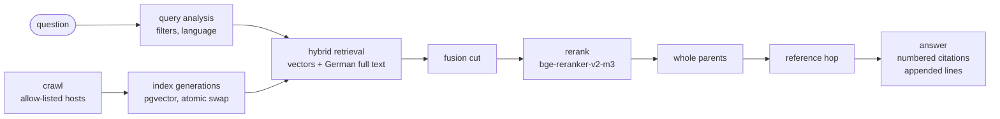

# rag-tuda

Cited answers on open-weight models, customised for TU Darmstadt's Fachbereich Informatik. A private proof-of-concept
showcase: a student project that answers questions about Bachelor, Master and PhD study rules, the examination regulations
(PO) and their versions, TU-wide rules and the residence permit for studying. It is **not an official service of TU
Darmstadt**, **not legal advice**, and every answer is AI-generated and without guarantee: check the cited source.

The assistant answers from its indexed documents only, each statement with a numbered link to its source and the PO version
it rests on; the language model's own knowledge serves only for conversation. It answers in German ("Sie"), or in the
question's language, and shapes an answer as a table, a checklist, a chart or a mind map when the question calls for one.
Everything runs on your own hardware. A question stays on the machine unless you choose a hosted model card (a `l-groq-...`
card); the page then shows which model and provider answer.

## What this showcases

- a configuration-driven crawler for a real university site (polite, robots.txt-aware, host allow-list);
- version-aware retrieval: hard filters for degree, programme, PO version and document type, with the filter named when
  nothing matches (never a silent unfiltered retry);
- hybrid search (vectors and German full text, with acronym expansion), fusion, whole-section reranking, a deterministic
  reference hop that resolves "§ n APB"-style references, and an LLM-driven extra round on the larger model classes;
- one architecture across model classes, from a 4B model on a laptop to a large open model on a GPU server.

## Quick start

Native mode needs an Apple-silicon Mac (16 GB or more), Docker (Colima, OrbStack or Docker Desktop), Ollama running
(`ollama serve`; on a 16 GB Mac start it as `LLAMA_ARG_CACHE_RAM=1024 ollama serve`, see
[`handbook/models.md`](handbook/models.md)), and [`uv`](https://docs.astral.sh/uv/).

```sh
uv run rag doctor     # checks the machine and lists the model cards it can run
uv run rag up         # the default profile is tu-informatik: it crawls the listed TU hosts, then indexes
uv run rag up --profile example --yes   # the bundled labour-law example: no crawl at all
```

`rag up` starts Postgres in Docker on `127.0.0.1:55432`, migrates, starts the embedding (8701) and reranker (8702) servers and
the backend (8700) as processes of yours (pid files in `.rag/pids`, logs in `.rag/logs`), builds the index when there is none,
creates the Ollama model `rag-<card>` with the card's window, sends a first request to load it and prints the link. The
crawl of the default profile is polite: about one request per second per host. `--profile` defaults to the profile this
folder was last started with, else `tu-informatik`; naming another profile switches, and a name without a
`profiles/<name>/profile.yaml` is refused before any step, with the profiles that exist. A model that is already on the
machine is not downloaded again, and nothing is downloaded without your yes (`--yes` or the prompt); for every profile but
`example` the prompt also names the docling layout and table models and the EasyOCR weights that the indexer fetches itself
at the first PDF. The index counts as built for a profile when the indexer's stats name that profile and the database volume
is older than the stats; otherwise `up` builds it, so switching profiles builds the other profile's index and a removed
volume is rebuilt. A second `up` changes nothing.

The default profile's core set (the department's study pages and regulations, the university-wide regulations, the residence
pages and two laws) came to about 270 pages, about 50 PDFs, 3666 sections and 15472 chunks. On an M2 Pro with 16 GB the crawl and
the PDF downloads took about 8 minutes and the embedding and build 3 minutes 14 seconds. (A re-crawl of the same set gave 3637
sections and 15373 chunks, the index of the embedder table below.) The full set (`rag reindex --full`) adds the TU-wide study
rules and the Landkreis pages: 6799 sections and 29794 chunks in the published index (the build's own `children` count is 29810)
from 1487 pages (1213 on `www.tu-darmstadt.de`, 265 on the faculty host, 5 on `www.ladadi.de`, 3 on
`digitales-rathaus.darmstadt.de`, 1 on `www.intern.tu-darmstadt.de`), about 177 PDFs and 2 laws, as they stand after
a further build that applies the `exclude` list (about two minutes, everything from the cache). The two builds before it, which
brought the index to 6972 sections, took about 42 minutes (30 + 12; the first sent 1750 requests) on top of a core index whose
chunks were cached; a full build from nothing was not timed. The crawl sizes that `rag up`, `rag reindex` and `rag doctor` print and
the "takes hours" of `rag reindex --help` are design estimates, not these measurements.

The commands:

| Command | What it does |
|---|---|
| `uv run rag doctor` | checks the machine and picks a class; `--card` shows one card's download size and whether it fits |
| `uv run rag up` | brings the stack up; `--card`, `--profile` (only a profile that exists), `--mode native\|compose`, `--model`, `--llm-url`, `--yes` |
| `uv run rag ask "<question>"` | asks one question and streams the cited answer; `--degree`, `--programme`, `--po`, `--lang` |
| `uv run rag reindex` | builds a new index generation from a re-crawl, swaps it in and restarts the backend; `--full`, `--resume` |
| `uv run rag rollback` | makes the previous index generation live again and restarts the backend; refused when the index was built for another profile than the stack runs (to go back to a profile, use `rag up --profile <name>`) |
| `uv run rag eval` | the deploy smoke (stream structure) against the running stack; `--smoke` plays the profile's smoke set with the answer checks; `--retrieval-only [--ablation]` scores retrieval alone, native mode only |
| `uv run rag add <folder>` | registers a folder of your own documents (Markdown, text, PDF) as a source; then `rag reindex` |
| `uv run rag down` | stops everything (safe to repeat; data stays); `--purge --yes` also deletes `.rag/crawl` and `.rag/snapshots`, and fails naming the path and the remedy when files stay behind (written as root by a container) |

## Profiles

A profile holds everything specific to one document collection. Two exist:

- `profiles/tu-informatik` (the default): the department's and the university's pages, crawled from the hosts in its
  `sources.yaml` (see [Sources and rights](#sources-and-rights)).
- `profiles/example`: ten German federal labour laws, read by the `folder` connector. It is the profile CI uses and a demo
  that needs no crawl.

## Architecture at a glance



```text
page (web/page) --GET /api/chat, server-sent events--> backend (FastAPI, one pipeline slot)
  backend: 1 query analysis ............. the card's OpenAI-compatible endpoint (Ollama natively)
           2 search: the question's vector ... embedding_service (snowflake-arctic-embed-m-v2.0)
                     sections and full text .. pgvector (views rag_chunks, rag_sections)
           3 rerank ..................... reranker_service (bge-reranker-v2-m3)
           4 answer, streamed with citations . the card's OpenAI-compatible endpoint
indexer (a one-off container or process, `indexer build`) -> a new index generation -> views repointed -> the backend reloads it on its next start
evals (a job container, never running on its own): probe runs, the gate and the smoke, over HTTP to the backend
```

The answer endpoint is the one the model card names: Ollama on the machine for the S and M cards, Groq's hosted endpoint for
the L cards, and a vLLM server for the XL card, which is documented but untested (see below). The stream (format 1) sends
`meta` first, then `status` (five steps), `docs`, `chunk`, `citations` and `error` frames, and `done` last; each frame is
`data: <json>` followed by a blank line. The compose file publishes one host port, the backend's `127.0.0.1:8700`;
everything else is reached on the compose network or with `docker exec`. More in [`handbook/architecture.md`](handbook/architecture.md).

## Models and classes

A model card (`models/cards/*.toml`) names the answer model, its endpoint, its window and its timeouts. The classes:

| Class | Cards | Where it runs |
|---|---|---|
| S | `s-qwen3-4b-instruct-2507` (default, about 2.5 GB), `s-qwen3.5-4b` (4.0 GB), `s-gemma4-e4b` (9.5 GB) | Ollama on the machine |
| M | `m-qwen3.6-35b-a3b` (22.6 GB), `m-qwen3.8-27b` (17.7 GB), `m-gemma4-31b` (20.4 GB) | Ollama on the machine |
| L | `l-groq-gpt-oss-120b`, `l-groq-gpt-oss-20b`, `l-groq-qwen3.8-27b` | Groq's hosted endpoint; analysis, embedding and reranking stay local |
| XL | `xl-vllm-example` | a vLLM server on NVIDIA GPUs; shipped as an example to copy, not tested |

**What is measured.** Every measurement of the TU profile in this README comes from one machine, an Apple M2 Pro with 16 GB
(10.4 GB usable), macOS 26, Ollama 0.40.17 started with `LLAMA_ARG_CACHE_RAM=1024`, on AC power unless a line says "on
battery"; the exceptions, named as such, are an M1 Max line and the example profile's four-question run. Figures called
estimates (the crawl sizes and the "takes hours" the commands print) are not measurements. Each cell is one run.

*Speed of the S cards* (M2 Pro, 16 GB): at the full 8K-token window the first token comes after 21 s
(`s-qwen3-4b-instruct-2507`), 20 s (`s-qwen3.5-4b`) or 18 s (`s-gemma4-e4b`), and a 700-token answer ends after 41, 37 or 35 s;
decoding runs at 36 to 42 tokens/s. On an M1 Max with 64 GB (Ollama 0.40.12) the default card reached the first token of a
6K-token prompt after 16.4 s, decoding at 25 to 33 tokens/s. A whole answer of the default card takes 25 to 26 s at the
median on the M2 Pro on AC (25.0, 25.9 and 26.3 s in three runs) and about 27 s in two runs on battery, mostly the prefill of the prompt; decoding a median answer (86 tokens) takes 2 to 3 s. The S cards'
timeouts (`deadline_s` 150, `idle_s` 60, `llm_read_s` 60, `analysis_s` 40) are well above these cases because they also have
to cover the retrieval's own waits (one `get_docs` call can be silent for about 57 s); a Mac much slower than this one may
still need them raised. Ollama 0.40.17 answers HTTP 501 to a `response_format` for `qwen3.5:4b` and `gemma4:e4b`, so their
cards ask for JSON in the prompt (`structured_output = "prompt"`); the default card's tag takes the schema.

*Answer quality of the S cards* (M2 Pro, 16 GB; `rag eval --smoke`: the 35 questions of `profiles/tu-informatik`, full index,
generation 6):

| Card | ok | fail | stale | Median answer time |
|---|---|---|---|---|
| `s-qwen3-4b-instruct-2507` (default) | 32 | 2 | 1 | 26.3 s |
| `s-qwen3.5-4b`, on battery, earlier code state | 26 | 7 | 2 | 28.9 s |
| `s-gemma4-e4b`: not measured validly | (24) | (10) | (1) | (34.6 s, 35.8 s) |

`stale` is a fee or date answer whose content checks failed (here S35, which the model refused as out of scope); it stays in the denominator of 35.
The `s-qwen3.5-4b` row was taken on battery and on an earlier code state, before the fix that reads grouped citations such as
"[1, 2]"; the relevance floor was 0.0, as it is now, and qwen3 models write no grouped citations, so the fix changes nothing
for that card. The default card is the winner of its class: it is six questions (0.17) ahead of `s-qwen3.5-4b`, the smallest download (2.5 GB)
and not slower. `s-gemma4-e4b` has no valid run: two runs were void because the reranker timed out on one to two retrievals
(swap 7 to 10 GB, the model takes 9.5 GB of the 10.4 GB usable). Their results, in brackets, only indicate that it does not
beat 32 of 35.

*Memory on a 16 GB Mac.* With `LLAMA_ARG_CACHE_RAM=1024` and the reranker's batch of 4 pairs on MPS, the three model processes
(embedder, reranker, Ollama) together used 9.8 GB at the busiest sample of a retrieval-only run, against about 10.4 GB
usable, without the Colima VM (about 1.5 GB more). Ollama was nearly idle in that run, so this is not a measurement made
during answers; in the last smoke run of the default card swap stood at 6.8 to 8.3 GB. A stack that has run several builds
holds more (the reranker keeps 5 GB instead of 3 GB until it is restarted). Reranker batches of 2 and 1 were not measured.

**What is not measured.** The M, L and XL cards have no measurement of any kind, because they do not fit this machine or need
an account: no speed, quality or memory numbers for them are given. Also unmeasured: `Qwen/Qwen3-Embedding-4B` and
`Qwen/Qwen3-Reranker-4B` (neither fits this Mac beside the rest: the embedder's load alone pushed swap up by more than 4 GB),
the Groq cards (no key; their structured-output behaviour is unknown), `s-gemma4-e4b` on a machine that holds it validly, and
every number on a question set larger than 35. The M-class prompts are untested.

**vLLM (XL).** `deploy/compose.vllm.yaml` serves the card's model at a pinned revision and loads the weights offline from the
host's Hugging Face cache (`~/.cache/huggingface`). Download that revision there first (the revision is in the `--revision`
flag of `compose.vllm.yaml`, for example with `hf download Qwen/Qwen3-235B-A22B-Instruct-2507-FP8 --revision <revision>`); the
container starts with `HF_HUB_OFFLINE=1` and downloads nothing itself. To serve another model, copy the card and change both
together.

**Hosted cards (Groq).** A `l-groq-...` card needs `GROQ_API_KEY` in the environment of `rag up`; the key goes to the backend
process only and is never stored. Groq's free-tier data terms have not been read in full: enter no personal matters while a
remote card is active. Only the generation call leaves the machine, to the card's endpoint.

## Evaluation

`uv run rag eval` runs the deploy smoke against the running stack: the fixed probes of the profile's `gate.yaml` (five in the example
profile: about six requests, about two minutes). It checks the structure of the stream only, so a correct deploy does not fail on answer variance: no
error frames, the time to first token, the sequence of status steps, and the `docs`, `chunk` and `citations` frames. The checks
on the answers themselves (each `[n]` maps to a source, the language equals the question's, the PO-version line, "Sie" in
German answers, the residence disclaimer) belong to the gate and probe runs of `apps/evals`, not to the smoke.

`uv run rag eval --smoke` plays the profile's whole smoke set (`smoke/smoke_v1.json` of `profiles/tu-informatik`: hand-written
questions, some asked with the page's degree, programme or PO chips) and applies the answer checks above to each answer. A
question whose answer is a fee or a date (`retrieval.volatile` in `gate.yaml`) prints `stale` instead of `FAIL` when only its content checks fail. The
quote of each question's gold source was copied from the crawl; `--retrieval-only` reports a gold whose quote is in no section of
its url as stale and leaves it out of the scores. The answer results of the S cards are under [Models and classes](#models-and-classes).

`uv run rag eval --retrieval-only` scores retrieval alone: for each question of the gate's probe sets, the rank of its gold
source after fusion and after reranking (hit@k and MRR). It runs against the native stack only. With `--ablation` it adds one
row per retrieval stage turned on, cumulatively: no filters, + filters, + acronyms, + fusion cut, + whole parents, + reference
hop.

### Results on the TU profile

Machine for every table below: M2 Pro, 16 GB, macOS 26, Ollama 0.40.17 with `LLAMA_ARG_CACHE_RAM=1024`, AC power unless a line
says otherwise; embedder `snowflake-arctic-embed-m-v2.0`, reranker `bge-reranker-v2-m3` (batch 4 on MPS), default card, unless the
table varies them. The questions are the 35 of the smoke set: 32 have a gold source, 3 (S18 to S20) have no answer in
the corpus by design; the embedder table has 27 golds (a 30-question version of the set, 3 without a gold).

**Embedder** (core index, 3637 sections, 27 golds; hit@k is the share of questions whose gold is in the first k):

| Embedder | Stage | hit@1 | hit@3 | hit@5 | hit@10 | MRR |
|---|---|---|---|---|---|---|
| arctic-embed-m-v2.0 (768) | fusion | 0.63 | 0.78 | 0.81 | 0.93 | 0.715 |
| | reranked | 0.59 | 0.81 | 0.81 | 0.81 | 0.679 |
| arctic-embed-l-v2.0 (1024) | fusion | 0.67 | 0.78 | 0.85 | 0.89 | 0.747 |
| | reranked | 0.56 | 0.85 | 0.85 | 0.85 | 0.679 |

After reranking `l` is ahead by 0.04 in hit@5 (one question) and equal in MRR: noise. The tie goes to the smaller and faster
`m`: its retrieval takes a median 3.25 s (max 4.85 s) against 3.50 s (7.56 s). **Winner: `snowflake-arctic-embed-m-v2.0`.**
`Qwen3-Embedding-4B` did not load on this Mac and is not measured.

**Reranker** (full index, 32 golds, on battery 79 % to 56 %; the whole retrieval including the reranker, median and max):

| Reranker | hit@1 | hit@3 | hit@5 | hit@10 | MRR | Retrieval median / max |
|---|---|---|---|---|---|---|
| none (the fused list) | 0.53 | 0.75 | 0.78 | 0.91 | 0.657 | |
| bge-reranker-v2-m3 | 0.56 | 0.75 | 0.84 | 0.84 | 0.662 | 3.16 s / 4.47 s |
| Qwen3-Reranker-0.6B | 0.56 | 0.66 | 0.81 | 0.88 | 0.646 | 8.92 s / 12.54 s |

The Qwen reranker is 0.03 lower in hit@5 and 0.016 in MRR (noise), 2.8 times slower per retrieval (8.92 s against 3.16 s) and
3.2 times slower for the reranker call alone (8.0 s against 2.5 s), and heavier (peak 7.2 to 7.9 GB against 5.9 to 6.5 GB); its yes/no scores sit near 1.0 even on questions without an answer.
**Winner: `bge-reranker-v2-m3`.** `Qwen3-Reranker-4B` did not fit this Mac and is not measured.

**Retrieval ablation** (`rag eval --retrieval-only --ablation`, full index, 32 golds, 210 retrievals, none with a failed
rerank; each row adds one stage to the one above; the last row is the product):

| Stage | hit@1 | hit@3 | hit@5 | hit@10 | MRR | Median latency |
|---|---|---|---|---|---|---|
| no filters | 0.50 | 0.66 | 0.72 | 0.81 | 0.608 | 17.28 s* |
| + filters | 0.56 | 0.75 | 0.81 | 0.81 | 0.661 | 14.36 s* |
| + acronyms | 0.56 | 0.72 | 0.81 | 0.81 | 0.659 | 13.78 s* |
| + fusion cut | 0.59 | 0.81 | 0.88 | 0.88 | 0.702 | 2.04 s |
| + whole parents | 0.59 | 0.78 | 0.88 | 0.88 | 0.694 | 2.28 s |
| + reference hop | 0.59 | 0.78 | 0.88 | 0.88 | 0.694 | 2.28 s |

\* The first three rows send about 117 sections to the reranker. Their retrieval takes a median 13.8 to 17.3 s (max 28.9 s); the
first attempt, at the product's 15 s limit for the reranker, lost 53 reranks, so this run used a limit of 60 s. The product's
retrieval is the last row, with the fusion cut, and takes about 2 s. The latencies of the first three rows describe the ablation, not the product. The ablation ran with a relevance floor of 0.1; the
product's is 0.0. The floor changed no gold's rank, only the final list of two questions.

Reading it: the filters and the fusion cut each raise hit@5 by 0.07 to 0.09 (two to three questions) but hit@1 by only 0.06 and
0.03, below the 0.10 that counts as wide here; together they take hit@5 from 0.72 to 0.88, and the fusion cut also brings the
latency under the limit. Whole parents, acronyms and the reference hop show no measurable gain on this set (the
hop never added a section): the set cannot tell whether they help. Nothing reaches 1.00: from the fusion cut on, four golds
(S05, S22, S26 and S30) are not in the final list, so the set is not too easy. (The example profile's four-question set, measured on an M1 Max with 64 GB, does
reach 1.00 after reranking; it only shows that the eval runs.)

**How far these numbers carry.**

- One machine and one run per cell.
- 35 questions, 32 with a gold source (27 in the embedder table). One question is 0.03 to 0.04; a difference under 0.05 is noise
  and 0.10 is already wide. No two ablation rows differ by 0.10 except the first (no filters) against the last three.
- The questions were revised after a first run on the same set, so the set is not a blind test.
- The default card's runs: 27 of 30 (core index, the 30-question version of the set) and 31 of 35 (full index, on battery) failed S17, S26
  and S30; 32 of 35 (full index, the run in the table) passed S17 with the same two sources. S17 flips between runs: model noise
  of one question. A further 31 of 35 at a relevance floor of 0.1, no longer the setting, is left out.
- Not answered by the default card: S26 and S30 fail, S35 is refused as out of scope and printed `stale`; it stays in the
  denominator.
- Whole parents, acronyms and the reference hop show no gain here. Reranking lowers hit@10 against the fused list (0.91
  to 0.84 in the reranker table).
- The embedder was decided on the core index only.
- The reranker table and the ablation's last row differ (hit@5 0.84 and MRR 0.662 against 0.88 and 0.694) because the ablation's
  set has a German twin named in two more golds: never put the two in one column.
- The memory figure above comes from a retrieval-only run, not from answers; a stack aged by builds is larger until it is restarted.

## Sources and rights

- The crawled pages and PDFs live only in `.rag/crawl/` on your machine. They are never committed, never redistributed; the
  repository holds configuration and, in the smoke set, short quotes. The index is local and not to be redistributed: TU
  Darmstadt's imprint says its content may not be reproduced in other publications without consent.
- Answers quote short passages and link to the source.
- The crawler's host allow-list is `profiles/tu-informatik/sources.yaml`: `www.informatik.tu-darmstadt.de`,
  `www.intern.tu-darmstadt.de`, `www.tu-darmstadt.de`, `digitales-rathaus.darmstadt.de`, `www.gesetze-im-internet.de` (the
  statutes' official XML) and, in a full build, `www.ladadi.de`. `www.darmstadt.de` and `h-da.de` are never fetched. The
  crawler honours robots.txt (RFC 9309) and `<meta name="robots">`, and sends the user agent
  `rag-tuda/<version> (+<contact>)`.
- Set `RAG__CRAWL__CONTACT` in your environment to put a contact into the user agent; it is optional and is never read from
  a file in the repository. `rag reindex` prints a note when it is not set.
- README screenshots must come from the fixture mini-site, never from crawled pages; none is committed yet.

## Warnings

- **Not legal advice, not an official TU service.** The page footer says so too.
- **Prompt injection through crawled pages.** Text hidden in a page's markup (`hidden`, `aria-hidden="true"`, inline `display:none` or `visibility:hidden`) is dropped when
  a page is extracted; text hidden by a CSS class and the text of PDFs are not covered, and crawled text still reaches
  the model's prompt; treat an answer as a pointer to the source.
- **Remote cards.** Questions leave the machine only to the answer endpoint of a hosted card, and the page shows it. Groq's
  free-tier data terms are not fully read: no personal matters while a remote card is active.
- **No telemetry.** Every host port binds `127.0.0.1`, `/api/*` needs a Bearer token, and the backend's HTTP access log is off
  (the question is a GET parameter).

## Operations

Keep the index current with `rag reindex`, on a schedule. It needs Docker and the stack's Postgres running (a first `rag up`
done), and it crawls again, so schedule it rarely. `rag reindex --resume` continues an interrupted crawl; `rag reindex --full`
adds the full source set: about 42 minutes on the M2 Pro in two builds (30 + 12; they brought the index to 6972 sections) on top of a core index whose chunks were cached
(the first sent 1750 requests at one per second per host); a full build from nothing was not timed. The indexer's size check compares a build only with the last build of the same
profile and source set (core or full, plus your folders). `rag rollback` makes the previous generation live again, and it
stops when the index was built for another profile than the stack runs: after switching profiles, go back with
`rag up --profile <name>`, not with `rag rollback`.

The retention job removes conversations older than 90 days and Langfuse traces older than 30 days; without `--apply` it
only reports. In compose mode, from the repository root:

```sh
docker compose --env-file .env -f deploy/compose.yaml exec -T backend python -m assistant_api.retention --apply
```

Natively, with the environment `rag up` gives the backend (the profile, the card and the secrets folder):
`uv run --frozen --package assistant-api python -m assistant_api.retention --apply`. A run without tracing configured skips
the trace step and still exits 0 when the other steps worked.

A scheduled job has a bare environment. It needs `docker` and `uv` on its `PATH`, and with a hosted (`l-groq-...`) card the
backend restart fails unless `GROQ_API_KEY` is in the job's environment too; `RAG__CRAWL__CONTACT` is optional (`rag reindex`
only prints a note when it is unset).

One cron line, with a `PATH` (use the full path of `uv`, from `command -v uv`, and of this folder; add `GROQ_API_KEY=...` and
`RAG__CRAWL__CONTACT=...` lines beside `PATH` when you need them):

```text
PATH=/opt/homebrew/bin:/usr/local/bin:/usr/bin:/bin
17 3 * * 0  cd /path/to/rag-tuda && /path/to/uv run rag reindex >> .rag/logs/reindex.log 2>&1
```

One launchd example for the Mac, `~/Library/LaunchAgents/rag-tuda.reindex.plist`, loaded with
`launchctl load ~/Library/LaunchAgents/rag-tuda.reindex.plist`:

```xml
<?xml version="1.0" encoding="UTF-8"?>
<!DOCTYPE plist PUBLIC "-//Apple//DTD PLIST 1.0//EN" "http://www.apple.com/DTDs/PropertyList-1.0.dtd">
<plist version="1.0"><dict>
  <key>Label</key><string>rag-tuda.reindex</string>
  <key>WorkingDirectory</key><string>/path/to/rag-tuda</string>
  <key>ProgramArguments</key><array>
    <string>/path/to/uv</string><string>run</string><string>rag</string><string>reindex</string>
  </array>
  <key>EnvironmentVariables</key><dict>
    <key>PATH</key><string>/opt/homebrew/bin:/usr/local/bin:/usr/bin:/bin</string>
    <!-- with a hosted card also: <key>GROQ_API_KEY</key><string>...</string> -->
  </dict>
  <key>StartCalendarInterval</key><dict>
    <key>Weekday</key><integer>0</integer><key>Hour</key><integer>3</integer><key>Minute</key><integer>17</integer>
  </dict>
  <key>StandardOutPath</key><string>/path/to/rag-tuda/.rag/logs/reindex.log</string>
  <key>StandardErrorPath</key><string>/path/to/rag-tuda/.rag/logs/reindex.log</string>
</dict></plist>
```

Your own folders (`rag add <folder>`, then `rag reindex`) work in native mode only; compose mode prints a note on reindex and
rollback when folders are registered. `uv run rag down` stops the stack and keeps the data.

## Compose mode (x86_64 Linux or WSL2)

`uv run rag up --mode compose` runs the compose files below with the card, its window, the profile and the secrets taken from
`.rag/` (download the two model snapshots after your yes, build, then migrate, then up, pull the card's model after your yes,
then a first request to the answer model). The model servers' locks cover x86_64 Linux and Apple silicon only, so their images
do not build on an arm64 Linux host.

The stack needs Docker with compose. `deploy/compose.yaml` runs on the CPU with Ollama; add `-f deploy/compose.nvidia.yaml` for
NVIDIA GPUs on the model servers, and `-f deploy/compose.vllm.yaml` (named last) to serve the language model with vLLM
instead of Ollama. The compose file names the project `rag-tuda`, so containers are `rag-tuda-<service>-1` and volumes
`rag-tuda_<name>`. By hand, a fresh clone downloads the two model snapshots, builds, then migrates:

```sh
git clone <this repository> rag-tuda; cd rag-tuda
mkdir -p .rag; echo '{}' > .rag/indexer-overlay.yaml    # the TU profile has no folder sources; the default overlay names the example's law texts
cp .env_example .env    # then set BACKEND_REFRESH_TOKEN, RAG_PROFILE=tu-informatik (the default there is example) and RAG_INDEXER_OVERLAY=../.rag/indexer-overlay.yaml
uv run python -m rag_tuda.state init    # the secret files under secrets/ (0644 inside a 0700 folder: the containers do not run as root)
HF_HUB_DISABLE_XET=1 uv tool run --from huggingface_hub==0.36.2 huggingface-cli download Snowflake/snowflake-arctic-embed-m-v2.0 --revision 95c2741480856aa9666782eb4afe11959938017f
HF_HUB_DISABLE_XET=1 uv tool run --from huggingface_hub==0.36.2 huggingface-cli download BAAI/bge-reranker-v2-m3 --revision 953dc6f6f85a1b2dbfca4c34a2796e7dde08d41e
docker compose --env-file .env -f deploy/compose.yaml --profile build --profile evals build
docker compose --env-file .env -f deploy/compose.yaml up -d --wait pgvector
docker compose --env-file .env -f deploy/compose.yaml --profile migrate run --rm migrate
docker compose --env-file .env -f deploy/compose.yaml up -d
docker compose --env-file .env -f deploy/compose.yaml exec ollama ollama pull qwen3:4b-instruct-2507-q4_K_M
```

The two downloads go to `~/.cache/huggingface`, which compose mounts (set `RAG_HF_CACHE` in `.env` for another home); the model
servers load only from that cache and never download. Ollama starts without a model; the last command downloads the default
card's model (about 2.5 GB) once, and you run it after deciding to download. Pulling by hand is the manual path only:
`rag up --mode compose` pulls the card's model itself after your yes.

Then build the first index: `docker compose --env-file .env -f deploy/compose.yaml --profile build run --rm indexer build`.
The backend reports healthy (`/readyz`) only once an index is published. Every compose command names the file and the root
`.env`; a missing `--env-file` leaves `BACKEND_REFRESH_TOKEN` unset, and the backend then refuses every `/api` request.

## Repository layout

| Folder | What it holds |
|---|---|
| `src/rag_tuda/` | the command line (`doctor`, `up`, `down`, `reindex`, `rollback`, `eval`, `ask`, `add`) and the `.rag/` state (the token, the database role passwords, one secret folder per native process, pid files, logs); standard library only |
| `models/cards/` | one TOML file per model card |
| `apps/` | `assistant_api` (the backend: FastAPI app and runtime, settings, the LangGraph graph, the retrieval eval, its own image); `indexer` (settings, connectors found by entry point, the crawler, generations, the one-shot `indexer build` command and its status, housekeep, rollback and compare commands); `evals` (probe runner, gate, stats, compare, rescore, smoke; its own job image) |
| `packages/` | `rag_core` (shared code: settings, domain, ports, services, adapters) and `rag_testing` (the harness fakes and the fixture mini-site; never in a service image), workspace members |
| `profiles/` | `tu-informatik/` (profile, messages, prompts, roles, acronyms, sources) and `example/` (profile, messages, prompts, `gate.yaml` with the smoke probes in `probes/`, and the law texts in `documents/`) |
| `model_servers/` | the two model servers, `embedding/` and `reranker/`: each its own uv project and lock, outside the workspace |
| `deploy/` | `compose.yaml` (the stack, project `rag-tuda`), `compose.native.yaml` (Postgres alone on `127.0.0.1:55432`, for the native stack), `pgvector/` (settings, client authentication, init scripts, role names), `env/` (the overlays), the harness (`compose.ci.yaml`, `ci/`, `fakes/`) |
| `web/page/` | the chat client: static files, the vendored libraries, its unit and browser tests |
| `handbook/` | architecture, operations, evaluation, sources, models and design decisions |
| `tests/` | unit, contract (`contracts/`), harness (`integration/`) and repository tests |
| `secrets/` | credential files, never in git |
| `data/` | runtime data, not in git |

## Checks: just ci

For development (macOS or Linux): install `uv`, `just`, Docker with compose and buildx (on macOS through Colima: `colima start
--cpu 6 --memory 12`), gitleaks and pre-commit; then `uv sync --frozen --all-packages`, `pre-commit install --hook-type
pre-commit --hook-type pre-push` and `just ci`.

`just ci` runs, identically on a development machine and in CI: `lint` (ruff, deptry, gitleaks, the three locks), `types`
(basedpyright), `imports` (import-linter), `unit` (pytest, the coverage ratchet), `cli` (the command line's tests in an
environment holding the root project alone), `db-tests` (the tests that need a migrated pgvector), `contracts` (shared
fixtures, the stream schema, the profile's data), `model-servers` (each model server's tests in its own environment, with fake
models), `images`, `harness` (the real backend and indexer images against fake model servers) and `page` (the page's Node
tests, then its browser suite in Chromium against streams recorded from the TU leg; it needs Node and downloads Chromium on
the first run). `just pre-push` (the part without Docker) runs before every push.

`just harness example` runs the example profile's leg: the ten law texts of `profiles/example` are indexed and queried through
the real images.

`just harness tu` runs the TU profile's leg: the crawler reads the fixture mini-site (`packages/rag_testing`, two services of
the harness network that stand in for the faculty's and the university's hosts) under the profile's own host names, the
indexer's overlay routing those two hosts to the services, and the questions are asked of the index it builds. Nothing is
fetched from the internet.

## Profiles and sources

A profile holds what is specific to one deployment.

- `profile.yaml` holds the values that decide the index (chunking, extraction, the sources and their minimums, the embedding
  model) and the assistant's answer-affecting values (identity, ranking, history, guard, generation); it is baked into the
  indexer and assistant images, so an image tag fixes them. `messages.de.yaml` holds the assistant's German texts, under `labels`
  the origin labels of the sources, and `prompts/` its prompts, read by the backend from the image.
- `gate.yaml` (the example profile) holds the probe sets and thresholds `evals` measures a change against, and the fixed probes
  of `evals smoke`.
- `deploy/env/<env>.yaml` holds the technical values of one environment (endpoints, hosts, paths); the assistant's own technical
  values are `RAG__…` entries in the backend's compose environment (`deploy/compose.yaml`).
- A source is a connector registered under the entry point group `rag_core.connectors` and named in the profile with
  `connector:`. Today there are three, in the indexer: `folder` (Markdown, text and PDF files of a directory), `tuda_web` (the
  polite crawler over a host allow-list) and `law_xml` (statutes from the official XML).
- A new profile is a folder beside the existing ones under `profiles/`, built into the indexer, assistant and evals images with
  `--build-arg PROFILE=<folder>` (the other images carry no profile).

## Licence

All rights reserved; see [`LICENSE`](LICENSE). Third-party models, vendored libraries and data sources are listed in
[`NOTICE`](NOTICE).
